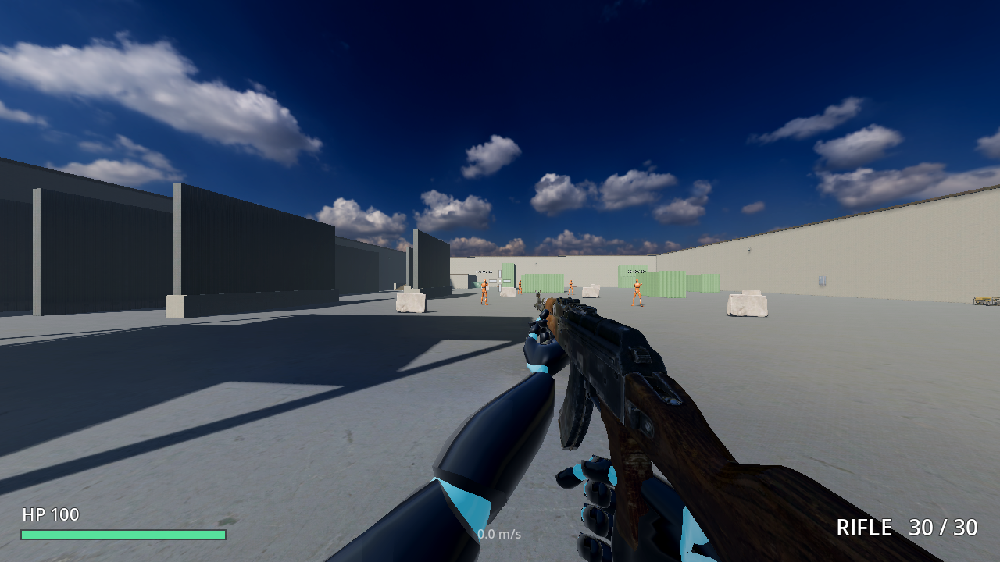
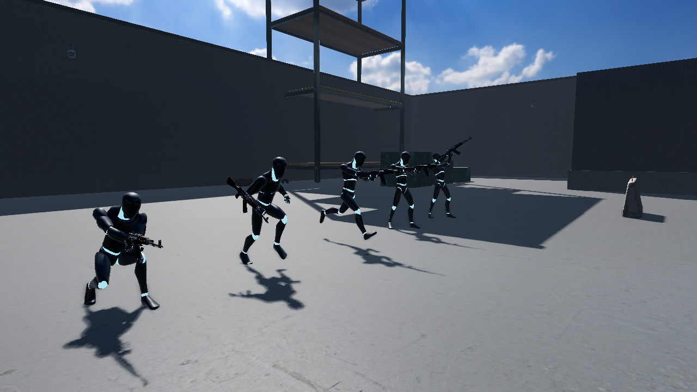

# Project Omnis

## A community-driven, open-source shooter

As an avid gamer myself, whenever a new game gets developed, you never know what you will get. From pay-to-win, to countless unbalanced characters/weapons and ultimately, a usually disappointed and angry fanbase.

Omnis' goal is to be the first community game. **You** play it, so if you don't like something or want to add something, you can!

That means a game that is open source end to end and can't be shut down: anyone can read the code, propose a change, or host a server.





## Status

Early prototype. The project restarted in 2026 on **[Godot 4.7](https://godotengine.org)** (MIT-licensed) after the original 2022 Unreal/Lyra draft. [Why we moved](docs/research/community-and-open-source-ai.md#2-a-blocker-to-fix-first-engine-licensing-not-an-ai-issue) · [roadmap](docs/progress.md)

What works today:

- **Training Garage**: an outdoor training yard built from photoscanned CC0 materials and props. It has a firing range with dummies at 15/30/50 m, a wall-run corridor and staggered wall-run panels, mantle blocks at 1, 1.5 and 2 m, a slide ramp and stacked containers.
- **Titanfall / Apex-style movement**:
  - Momentum-based ground movement with Source-style air strafing.
  - Sprint, crouch, and slide with a boost; slide-hop keeps your speed.
  - Double jump, wall-running, wall-jumps and mantling.
  - Tuning lives in [`game/player/movement/default.tres`](game/player/movement/default.tres).
- **Smooth at any frame rate**: physics interpolation, a camera updated every rendered frame, and snapshot interpolation for other players.
- Two hitscan weapons (rifle and pistol) using realistic CC0 models:
  - First-person arms whose hands are placed on the gun by inverse kinematics, so they follow sway, recoil and reloads.
  - View-model sway, bob and recoil; muzzle flash, tracers, impacts and bullet holes.
  - Animated third-person characters.
- **Audio**:
  - Recorded AK-47 and 1911 gunshots: close up for your own gun, distant takes for far-away players.
  - Reloads, footsteps that change with the surface (concrete or metal), and bullet impacts per surface.
  - Jump-jet, landing, slide, and wind at speed.
  - Hit-marker and kill ticks.
  - Other players' footsteps and shots are positional, so you can hear them coming.
- Graphics presets from Low to Ultra (FSR upscaling, SMAA/MSAA, SSAO, SSIL, volumetric fog, SDFGI), plus volume, FOV and sensitivity settings, in the menu and the in-game pause menu.
- Online multiplayer: host, join, or run a headless dedicated server. The server decides hits, damage, ammo and respawns.
- Weapon balance and movement tuning are stored as plain-text data, so a change is a one-line diff.

## Play it

1. Install **Godot 4.7.2** (standard build, not .NET): <https://godotengine.org/download>
2. Clone this repo, open Godot, **Import** → select `project.godot`
3. Press **F5**, click **Host**. To play together, a second player clicks **Join** with the host's IP (port `24680`, UDP).

Command line:

```bash
godot --path . -- --host                          # host and play
godot --path . -- --join=192.168.1.20             # join a server
godot --headless --path . -- --server --port=24680  # dedicated server
```

Controls:

- **WASD**: move
- **Shift**: sprint
- **Space**: jump; press again in the air to double jump
- **C** / **Ctrl**: crouch; slides when sprinting
- Jump next to a wall to wall-run
- **LMB**: fire
- **R**: reload
- **1/2**: switch weapon
- **Esc**: menu

Gamepad works too: left stick moves, right stick looks, A jumps, B crouches, RT fires.

## Run the tests

```bash
godot --headless --path . --import
godot --headless --path . -s tests/run_tests.gd   # unit + server-rule tests
GODOT=godot tests/smoke_multiplayer.sh            # real server + client
```

CI runs the same steps on every push and PR.

## Project layout

```
game/
  autoload/network.gd     connection management (autoloaded as `Network`)
  autoload/settings.gd    graphics presets, FOV, sensitivity (autoloaded as `Settings`)
  main/                   entry scene: menu, pause menu, launch flags
  player/                 player, movement motor, view model, HUD, server-side combat rules
  player/movement/*.tres  movement tuning
  characters/             animated third-person character
  weapons/data/*.tres     one text file per weapon (balance lives here)
  weapons/models/         weapon scenes and materials
  world/                  Training Garage map, materials, game-mode script, target dummy
  fx/                     muzzle flash, tracers, impacts (code only, no textures)
  audio/sfx.gd            sound banks and playback helpers
  assets/                 third-party CC0 models, textures, HDRI and audio (see CREDITS.md)
tools/                    asset fetch / import / audio build helpers
tests/                    headless tests and multiplayer smoke test
docs/                     roadmap, architecture, contributing, research
```

## Contributing

Read **[docs/contributing.md](docs/contributing.md)** first. It covers the proposal process, the AI-assistance policy, and asset rules. The design reasoning is in [docs/architecture.md](docs/architecture.md), and the background research is in [docs/research/](docs/research/).

A community Discord/Matrix will open once there's a playable loop worth gathering around.

## License

Code is under the [MIT License](LICENSE). Original art and audio are under CC BY 4.0. Third-party assets are CC0; [CREDITS.md](CREDITS.md) lists each one and its author.
