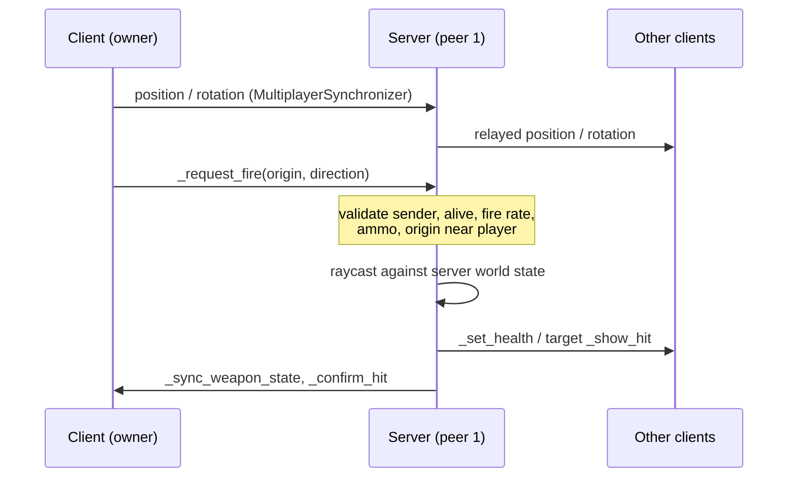

# Architecture

## Engine

Godot 4.7, GDScript, Forward+ renderer. Everything in the repo is text except binary assets, so changes review as normal diffs.

## Scene layout

```
Main (main.gd)                 entry scene; menu, pause menu, launch flags
├─ World (training_garage.tscn, world.gd)
│  ├─ WorldEnvironment / Sun / ReflectionProbe
│  ├─ Geometry                        CSG blocks with world-space triplanar PBR materials
│  ├─ Props / WallDressing            Poly Haven models (StaticProp adds box colliders)
│  ├─ Signs / Targets
│  ├─ SpawnPoints (Marker3D…)
│  ├─ Players                         spawned players live here
│  └─ PlayerSpawner (MultiplayerSpawner → Players)
├─ MenuCamera
├─ Menu (CanvasLayer)
└─ Pause (CanvasLayer)
Network (autoload)             ENet peer: host / join / dedicated server
Settings (autoload)            graphics preset, FOV, sensitivity → viewport + environment

Player (player.gd, CharacterBody3D)
├─ CollisionShape3D            capsule; height changes when crouching / sliding
├─ Character (character_model.gd)   animated third-person body + held weapon
├─ Head                        eye point (replicated pitch / height), used by the server
├─ Camera3D (top-level)        owner only; placed every rendered frame
│  └─ ViewModel                first-person weapons + arms (ArmIK)
├─ Audio (player_audio.gd)     shots, footsteps, movement sounds
├─ Synchronizer                replicates net_position / yaw / pitch / velocity / state / height
└─ HUD
```

Maps are scenes whose root uses `world.gd` (`World`). A new map needs `SpawnPoints`, `Players` and a `PlayerSpawner` pointing at `Players`.

## Networking model

The server is always peer 1. With `--server` it runs headless and doesn't spawn a player for itself.



| Concern | Who decides | Where |
|---|---|---|
| Movement, aim | **Owner client** (for now) | `Player._physics_process`, `Synchronizer` |
| Fire rate, ammo, reload | Server | `Player._request_fire`, `_server_start_reload` |
| Hit detection | Server raycast | `Player._request_fire` |
| Damage, health, death, respawn | Server | `take_damage`, `_server_respawn` |
| Spawning / despawning players | Server | `World._add_player` / `_remove_player` |

**Rules for new code:**

- RPCs that clients call: `@rpc("any_peer", …)`, and on the server check `multiplayer.get_remote_sender_id()` is the peer allowed to act.
- RPCs the server sends to a player node (whose authority is the owner client): `@rpc("any_peer", "call_local", …)` and accept only sender `1`.
- Never trust a client value you can recompute on the server.

### Known gaps (tracked in [progress.md](progress.md))

- **Client-authoritative movement.** A modified client can teleport or speed-hack, and richer movement makes speed checks harder. `PlayerMotor` is deterministic per input, so the fix is to replay inputs on the server (validation first, then prediction and rollback). The [netfox](https://github.com/foxssake/netfox) add-on (MIT) is the leading candidate. The server's shot-origin check already allows extra slack in proportion to speed.
- **No lag compensation.** The server raycasts against its latest state, so high-ping players must lead targets.
- **No visibility culling.** Every client receives every player's position, which enables wallhacks.
- Late joiners don't receive other players' current health or weapon.
- Third-person strafing turns the body up to 55° towards the movement direction and plays backpedalling in reverse. Proper 8-way blend spaces need directional clips.

As an open-source shooter, we can't rely on hiding client code. Cheat resistance has to come from the server: validation, culling and server-side behavioural detection. See research §3.7.

## Movement

`PlayerMotor` (`game/player/player_motor.gd`) is a plain class that moves the `CharacterBody3D` one physics tick at a time from a `MoveInput` snapshot. The player feeds it live input; tests feed it scripted input. It is the piece that would be replayed on the server for prediction and rollback later.

| State | What happens |
|---|---|
| `GROUND` | Source-style acceleration and friction, with walk, sprint (forward only) and crouch speeds. Jump buffer and coyote time. Friction is skipped for a few frames after landing, so a buffered jump keeps speed (bunny hop). |
| `AIR` | Heavier-than-real gravity. Air acceleration only caps speed *along* the wish direction, so strafing while turning bends momentum (air strafing). Also handles the double jump (can change direction), wall-jump when near a wall, mantle checks, and wall-run entry. |
| `SLIDE` | Starts by crouching above `slide_min_speed`, with a boost that has a cooldown. Linear deceleration; slopes add or remove speed. Jumping out keeps momentum (slide-hop). |
| `WALLRUN` | Starts when airborne, fast enough and beside a near-vertical wall. Gravity is reduced, then ramps back up; there's a time limit. Jumping kicks off the wall and refreshes the double jump. The same wall can't be re-attached until you touch the ground or another wall. |
| `MANTLE` | Waist-high obstacle in front, a walkable top within `mantle_max_height`, and room to stand: the player is moved up and over the edge. |

All numbers live in a `MovementSettings` resource (`game/player/movement/default.tres`). Movement changes can be proposed and playtested the same way as weapon balance.

## Smoothness

Fast movement exposes every hitch, so:

- **Physics interpolation is on.** Physics ticks at 60 Hz; bodies are drawn between ticks at any refresh rate.
- **The camera is top-level and opts out of interpolation.** Every rendered frame it is placed at the body's interpolated position, using the newest mouse look. Aim never waits for a physics tick.
- **Rule:** anything moved per rendered frame (`_process`) must set `physics_interpolation_mode = OFF` and read `get_global_transform_interpolated()` from what it follows. Examples are the camera, the third-person held weapon and the effects. Anything moved per tick stays interpolated. After teleports, call `reset_physics_interpolation()`.
- **Remote players** are drawn `INTERP_DELAY` (100 ms) in the past, interpolating between received snapshots. They extrapolate for at most 150 ms if packets are late. The server uses the newest state for hit detection instead.
- **No-clip view model.** First-person weapons are drawn at 0.3× scale and 0.3× distance. That looks identical, but the gun stays inside the player capsule, so it never pokes through walls and no second camera is needed.
- V-Sync is off by default, and TAA isn't used (it smears during fast motion).

## Rendering and assets

- Forward+ renderer. `Settings` applies a preset:
  - **Low:** FSR 1 at 77% scale, FXAA, hard shadows.
  - **Medium** (default): SMAA, SSAO.
  - **High:** adds MSAA 2×, SSIL and volumetric fog.
  - **Ultra:** adds MSAA 4×, SSR, SDFGI and 8K sun shadows.
- Map surfaces are CSG boxes with **world-space triplanar** ORM materials (Poly Haven ARM maps are already in Godot's ORM channel order). Any box size tiles correctly without UV work.
- The sun direction matches the sun in the HDRI sky. One box-projected reflection probe covers the map; it skips view models (layer 20) and characters (layer 2).
- Characters use Quaternius' CC0 animation library. An `AnimationTree` crossfades locomotion clips and blends an upper-body aim pose (filtered to spine and arms) driven by the replicated pitch.
- Asset sources and licences are in [CREDITS.md](../CREDITS.md). `tools/` holds the Poly Haven fetcher and the texture-import fixer.

## First-person arms

The view model shows your own arms: the same CC0 mannequin as the third-person character, with a dimmer accent colour.
- **Hiding.** The head and legs are collapsed, and the rig sits so the chest stays below the screen.
- **IK.** `ArmIK` (`game/player/arm_ik.gd`, a `SkeletonModifier3D`) solves analytic two-bone IK every frame, from shoulder to elbow to wrist, onto `GripR` and `GripL` markers on the weapon scene. Elbows bend towards pole markers. Each hand is rotated to its marker (marker -Z = knuckles, +Y = back of hand), and the fingers are curled around the grip.
- **Free animation.** Sway, recoil, sprint and swap motions only move the gun, and the hands follow. During a reload the support hand travels to the `MagWell` marker and drops out of view.
- **New weapons** need `GripR`, `GripL` and (optionally) `MagWell` markers. `tests/suite.gd` checks that both hands actually reach them.
- **Reading poses.** Modified poses only exist until skinning, so read them in `modification_processed`.

## Audio

- `Sfx` (`game/audio/sfx.gd`) holds the sound banks and fire-and-forget 2D/3D players.
- **Buses.** World sounds go to the `World` bus, which has a light outdoor reverb. `Master` has a hard limiter, so many overlapping shots can't clip. The volume setting drives `Master`.
- **One component, two outputs.** `PlayerAudio` reads the replicated `net_*` state:
  - For the **local** player it plays non-positional sounds and uses the motor's jump and land signals.
  - For **remote** players it plays 3D sounds, inferring jumps and landings from state changes.
  - So other players' footsteps, jets and landings are audible without extra network messages.
- **Surfaces.** `Sfx.surface_of(collider)` classifies concrete, metal or flesh for footsteps and impacts. Shot effects carry the surface id from the server.
- **Weapon sounds are data.** Each `WeaponData` has `fire_sounds` (close, stereo), `fire_sounds_far` (mid-distance takes, used beyond 25 m) and `reload_sound`.
- Dedicated servers (headless) play nothing.
- View-model and camera springs are integrated in fixed sub-steps (`ViewModel.spring`). A single big step on a slow frame made the recoil spring explode.

## Data-driven balance

`WeaponData` (`game/weapons/weapon_data.gd`) holds damage, rate of fire, range, magazine and reload time. Each weapon is a `.tres` text file. `tests/run_tests.gd` enforces guardrails on these values, such as "no weapon kills a full-health player in one shot".

## Testing

- `tests/run_tests.gd` loads `tests/suite.gd` at runtime, so the suite can use autoloads. It is headless and dependency-free, and covers:
  - data checks and argument parsing
  - scene loading
  - server combat rules, run offline (this process is peer 1)
  - movement, in a code-built test arena: speed caps, jump height, double jump, the air-strafe exploit guard, slide boost and decay, wall-run and wall-jump, mantle, and the low-ceiling crouch
  - snapshot interpolation, spring stability, audio data and surfaces, first-person hands reaching their grips, and every file under `game/assets/` being covered by CREDITS.md
- Before any test, the runner compiles every `.gd` file under `game/`, `tests/` and `tools/`. `untyped_declaration` is an error in `project.godot`, so untyped code fails here even if no test loads it.
- `tests/smoke_multiplayer.sh`: starts a real dedicated server and a client, then checks the client's player is spawned and replicated.
- `gdlint` (godot-gdscript-toolkit, pinned) checks style; settings are in `gdlintrc`.
- CI (`.github/workflows/ci.yml`): a lint job and a test job. Godot version pinned with checksum verification, read-only token, no secrets.
- Why it's set up this way, and what's deferred (GUT/gdUnit4, perf benchmarks, network simulation): [research/engineering-practices.md](research/engineering-practices.md).
