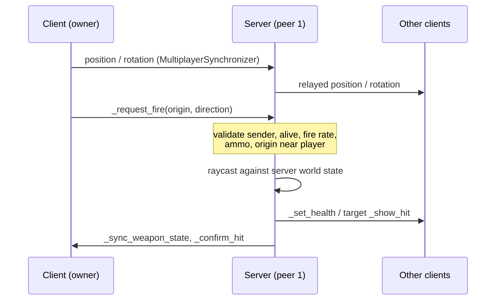

# Architecture

## Engine

Godot 4.7, GDScript, Forward+ renderer. Everything in the repo is text except binary assets, so changes review as normal diffs.

## Scene layout

```
Main (main.gd)                 entry scene; menu + launch flags
├─ World (training_garage.tscn, world.gd)
│  ├─ Geometry / Signs / Targets      map content (CSG greybox for now)
│  ├─ SpawnPoints (Marker3D…)
│  ├─ Players                         spawned players live here
│  └─ PlayerSpawner (MultiplayerSpawner → Players)
├─ MenuCamera
└─ Menu (CanvasLayer)
Network (autoload)             ENet peer: host / join / dedicated server
```

Maps are scenes whose root uses `world.gd` (`World`). A new map needs `SpawnPoints`, `Players` and a `PlayerSpawner` pointing at `Players`.

## Networking model

The server is always peer 1. With `--server` it runs headless and doesn't spawn a player for itself.



| Concern | Who decides | Where |
|---|---|---|
| Movement, aim | **Owner client** (for now) | `Player._physics_process`, `Synchronizer` |
| Fire rate, ammo, reload | Server | `Player._request_fire`, `_server_start_reload` |
| Hit detection | Server raycast | `Player._request_fire` |
| Damage, health, death, respawn | Server | `take_damage`, `_server_respawn` |
| Spawning / despawning players | Server | `World._add_player` / `_remove_player` |

**Rules for new code:**

- RPCs that clients call: `@rpc("any_peer", …)`, and on the server check `multiplayer.get_remote_sender_id()` is the peer allowed to act.
- RPCs the server sends to a player node (whose authority is the owner client): `@rpc("any_peer", "call_local", …)` and accept only sender `1`.
- Never trust a client value you can recompute on the server.

### Known gaps (tracked in [progress.md](progress.md))

- **Client-authoritative movement.** A modified client can teleport or speed-hack. The fix is to validate movement on the server, and eventually add server-authoritative movement with client prediction and lag compensation. The [netfox](https://github.com/foxssake/netfox) add-on (MIT) is the leading candidate.
- **No lag compensation.** The server raycasts against its latest state, so high-ping players must lead targets.
- **No visibility culling.** Every client receives every player's position, which enables wallhacks.
- Late joiners don't receive other players' current health or weapon.

As an open-source shooter, we can't rely on hiding client code. Cheat resistance has to come from the server: validation, culling and server-side behavioural detection. See research §3.7.

## Data-driven balance

`WeaponData` (`game/weapons/weapon_data.gd`) holds damage, rate of fire, range, magazine and reload time. Each weapon is a `.tres` text file. `tests/run_tests.gd` enforces guardrails on these values, such as "no weapon kills a full-health player in one shot".

## Testing

- `tests/run_tests.gd`: headless, dependency-free. Covers data checks, argument parsing, scene loading, and server combat rules run offline (this process is peer 1).
- `tests/smoke_multiplayer.sh`: starts a real dedicated server and a client, then checks the client's player is spawned and replicated.
- CI (`.github/workflows/ci.yml`): pinned Godot version with checksum verification, read-only token, no secrets.
